# Aspect 1 (RLAIF reliability): results

_Auto-generated by `scripts/analyze.py`; see `FINDINGS.md` for the interpretation._

## 1. Pre-training audit: global judge quality

Natural base-policy samples, verdict = P(Yes) > 0.5. `fp_share_low_tercile`: share of all false accepts that fall on the least-verifiable third of problems.

| task | judge | mode | tpr | fpr | youden | base_gold | judge_solve | fp_share_low_tercile | frac_problems_neg_youden |
|---|---|---|---|---|---|---|---|---|---|
| countdown | qwen3-0.6b | standard | 0.987 | 0.278 | 0.709 | 0.404 | 0.074 | 0.616 | 0.023 |
| countdown | qwen3-0.6b | commit_first | 0.997 | 0.536 | 0.461 | 0.404 | 0.074 | 0.475 | 0.133 |
| countdown | qwen3-1.7b | standard | 1.000 | 0.303 | 0.697 | 0.404 | 0.408 | 0.640 | 0.016 |
| countdown | qwen3-1.7b | commit_first | 0.998 | 0.342 | 0.657 | 0.404 | 0.408 | 0.601 | 0.047 |
| countdown | qwen3-4b | standard | 0.955 | 0.214 | 0.741 | 0.404 | 0.467 | 0.684 | 0.008 |
| math | qwen3-0.6b | standard | 0.990 | 0.435 | 0.555 | 0.644 | 0.544 | 0.887 | 0.039 |
| math | qwen3-0.6b | commit_first | 0.863 | 0.528 | 0.335 | 0.644 | 0.544 | 0.810 | 0.227 |
| math | qwen3-1.7b | standard | 1.000 | 1.000 | 0.000 | 0.644 | 0.642 | 0.876 | 0.344 |
| math | qwen3-1.7b | commit_first | 1.000 | 0.998 | 0.002 | 0.644 | 0.642 | 0.875 | 0.344 |
| math | qwen3-4b | standard | 0.925 | 0.230 | 0.695 | 0.644 | 0.786 | 0.778 | 0.055 |

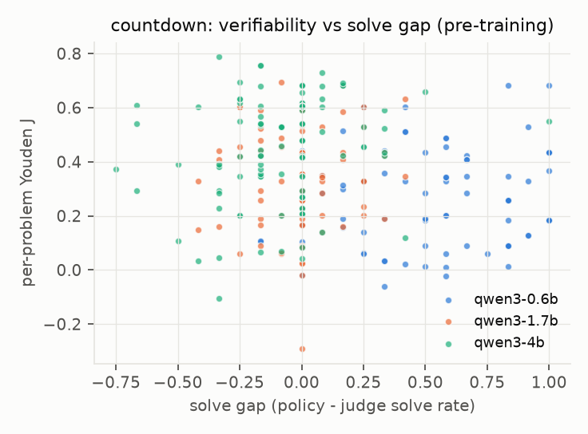 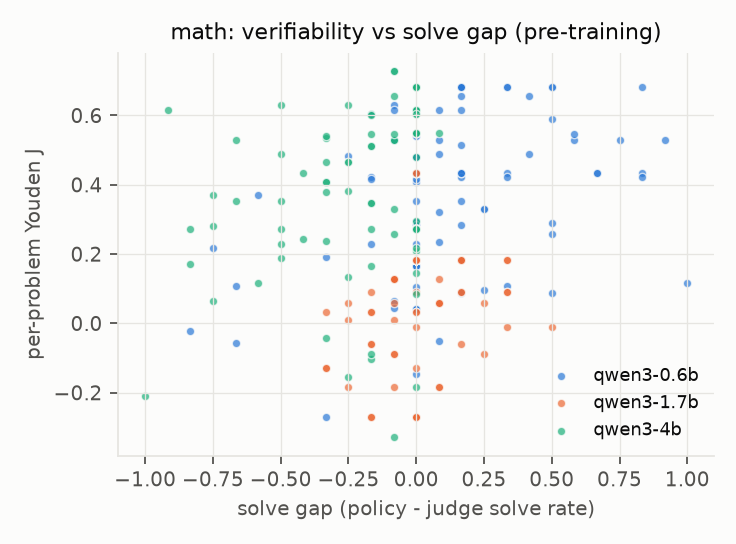

## 2. GRPO runs

| run | task | lr | steps | heldout_gold_0 | heldout_gold_peak | heldout_gold_final | train_fp_first16 | train_fp_last16 | collapse_onset | pretrain_global_youden | online_youden_at_onset | outsolve_step |
|---|---|---|---|---|---|---|---|---|---|---|---|---|
| countdown/j0.6b_commit_first_train_s0 | countdown | 5e-05 | 128 | 0.430 | 0.430 | 0.000 | 0.435 | 0.992 | 19 | 0.461 | 0.115 | 0 |
| countdown/j0.6b_standard_drop_gap_s0 | countdown | 5e-05 | 128 | 0.430 | 0.430 | 0.039 | 0.301 | 0.971 | 15 | 0.709 | 0.078 | 0 |
| countdown/j0.6b_standard_drop_lowver_s0 | countdown | 5e-05 | 128 | 0.430 | 0.430 | 0.008 | 0.454 | 0.977 | 10 | 0.709 | 0.094 | 0 |
| countdown/j0.6b_standard_train_lr1e-5_s0 | countdown | 1e-05 | 128 | 0.430 | 0.430 | 0.211 | 0.213 | 0.733 | 22 | 0.709 | 0.138 | 0 |
| countdown/j0.6b_standard_train_s0 | countdown | 5e-05 | 128 | 0.430 | 0.430 | 0.180 | 0.495 | 0.893 | 9 | 0.709 | 0.025 | 0 |
| countdown/j1.7b_commit_first_train_s0 | countdown | 5e-05 | 128 | 0.406 | 0.406 | 0.250 | 0.451 | 0.710 | 10 | 0.657 | 0.118 | 1 |
| countdown/j1.7b_standard_train_s0 | countdown | 5e-05 | 128 | 0.406 | 0.406 | 0.250 | 0.428 | 0.726 | 10 | 0.697 | 0.124 | 1 |
| countdown/j4b_standard_train_lr1e-5_s0 | countdown | 1e-05 | 128 | 0.406 | 0.406 | 0.258 | 0.128 | 0.660 | 25 | 0.741 | 0.500 | 21 |
| countdown/j4b_standard_train_s0 | countdown | 5e-05 | 128 | 0.406 | 0.406 | 0.203 | 0.412 | 0.716 | 10 | 0.741 | 0.149 | n/a |
| math/j0.6b_commit_first_train_s0 | math | 5e-05 | 96 | 0.633 | 0.766 | 0.734 | 0.163 | 0.208 | n/a | 0.335 | n/a | 4 |
| math/j0.6b_standard_drop_gap_s0 | math | 5e-05 | 96 | 0.633 | 0.789 | 0.703 | 0.173 | 0.233 | n/a | 0.555 | n/a | 0 |
| math/j0.6b_standard_drop_lowver_s0 | math | 5e-05 | 96 | 0.633 | 0.773 | 0.758 | 0.148 | 0.195 | 34 | 0.555 | 0.000 | 0 |
| math/j0.6b_standard_train_s0 | math | 5e-05 | 96 | 0.633 | 0.750 | 0.742 | 0.170 | 0.242 | 46 | 0.555 | 0.015 | 4 |
| math/j0.6b_standard_train_s1 | math | 5e-05 | 96 | 0.633 | 0.781 | 0.719 | 0.174 | 0.250 | 54 | 0.555 | 0.023 | 0 |
| math/j1.7b_standard_train_s0 | math | 5e-05 | 96 | 0.594 | 0.703 | 0.703 | 0.316 | 0.245 | n/a | 0.000 | n/a | 6 |
| math/j4b_standard_train_s0 | math | 5e-05 | 96 | 0.594 | 0.766 | 0.703 | 0.085 | 0.059 | n/a | 0.695 | n/a | 34 |

### Run level: pre-training judge statistics vs outcome

`planted_wrong_accept`: how often the judge accepts a planted wrong answer that claims to be right; `delta_heldout_gold`: final - initial held-out gold accuracy.

| run | task | global_youden | mean_youden | mean_auroc | mean_bon_fool_16 | planted_wrong_accept | mean_solve_gap | delta_heldout_gold | collapse_onset |
|---|---|---|---|---|---|---|---|---|---|
| countdown/j0.6b_commit_first_train_s0 | countdown | 0.461 | 0.185 | 0.808 | 0.500 | 0.746 | 0.329 | -0.430 | 19 |
| countdown/j0.6b_standard_drop_gap_s0 | countdown | 0.709 | 0.335 | 0.848 | 0.381 | 0.792 | 0.159 | -0.391 | 15 |
| countdown/j0.6b_standard_drop_lowver_s0 | countdown | 0.709 | 0.398 | 0.898 | 0.292 | 0.766 | 0.295 | -0.422 | 10 |
| countdown/j0.6b_standard_train_lr1e-5_s0 | countdown | 0.709 | 0.319 | 0.851 | 0.309 | 0.789 | 0.329 | -0.219 | 22 |
| countdown/j0.6b_standard_train_s0 | countdown | 0.709 | 0.319 | 0.851 | 0.309 | 0.789 | 0.329 | -0.250 | 9 |
| countdown/j1.7b_commit_first_train_s0 | countdown | 0.657 | 0.245 | 0.877 | 0.275 | 0.711 | -0.004 | -0.156 | 10 |
| countdown/j1.7b_standard_train_s0 | countdown | 0.697 | 0.393 | 0.859 | 0.386 | 0.438 | -0.004 | -0.156 | 10 |
| countdown/j4b_standard_train_lr1e-5_s0 | countdown | 0.741 | 0.459 | 0.885 | 0.276 | 0.184 | -0.064 | -0.148 | 25 |
| countdown/j4b_standard_train_s0 | countdown | 0.741 | 0.459 | 0.885 | 0.276 | 0.184 | -0.064 | -0.203 | 10 |
| math/j0.6b_commit_first_train_s0 | math | 0.335 | 0.381 | 0.904 | 0.250 | 0.207 | 0.100 | 0.102 | n/a |
| math/j0.6b_standard_drop_gap_s0 | math | 0.555 | 0.463 | 0.949 | 0.245 | 0.307 | -0.023 | 0.070 | n/a |
| math/j0.6b_standard_drop_lowver_s0 | math | 0.555 | 0.563 | 0.969 | 0.105 | 0.198 | 0.135 | 0.125 | 34 |
| math/j0.6b_standard_train_s0 | math | 0.555 | 0.451 | 0.938 | 0.206 | 0.305 | 0.100 | 0.109 | 46 |
| math/j0.6b_standard_train_s1 | math | 0.555 | 0.451 | 0.938 | 0.206 | 0.305 | 0.100 | 0.086 | 54 |
| math/j1.7b_standard_train_s0 | math | 0.000 | 0.030 | 0.895 | 0.268 | 0.992 | 0.002 | 0.109 | n/a |
| math/j4b_standard_train_s0 | math | 0.695 | 0.473 | 0.899 | 0.137 | 0.027 | -0.143 | 0.109 | n/a |

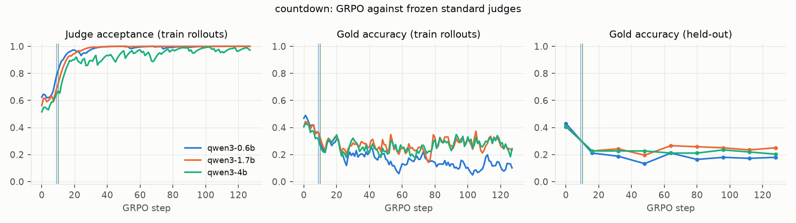

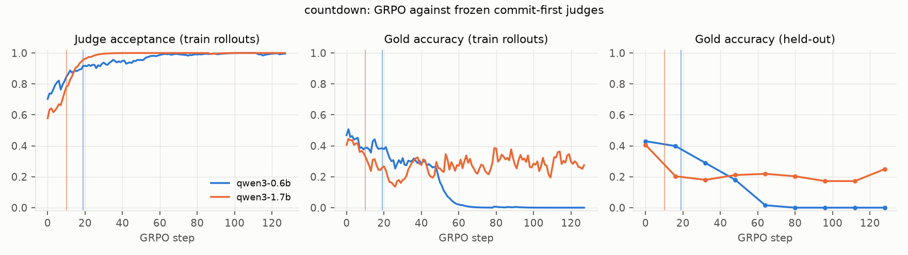

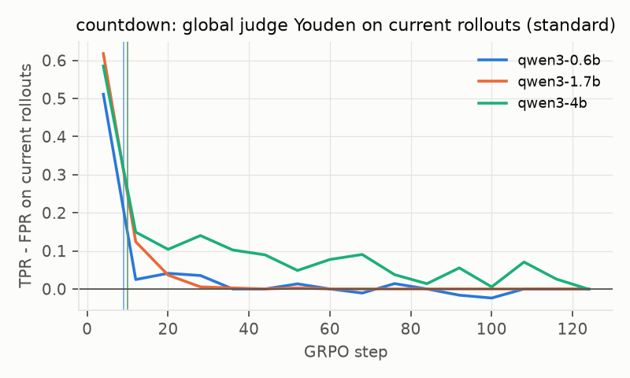 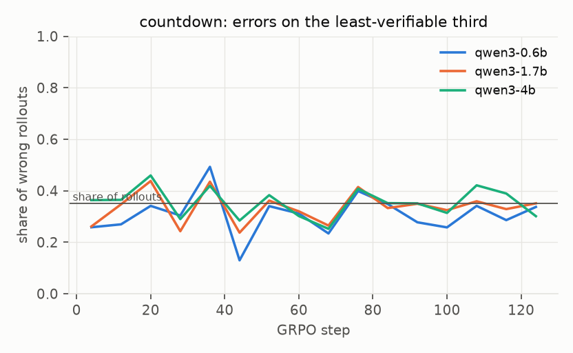

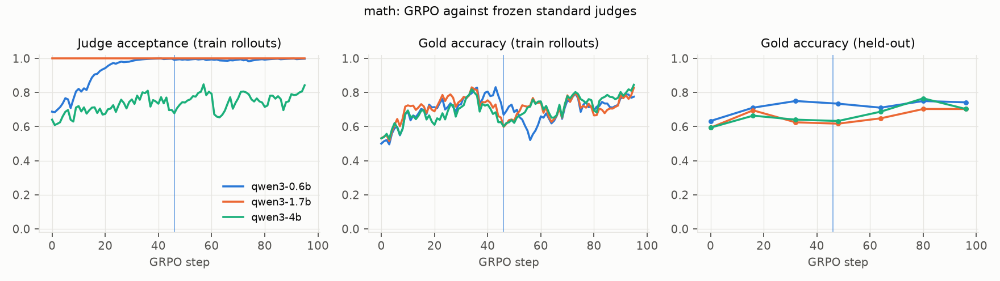

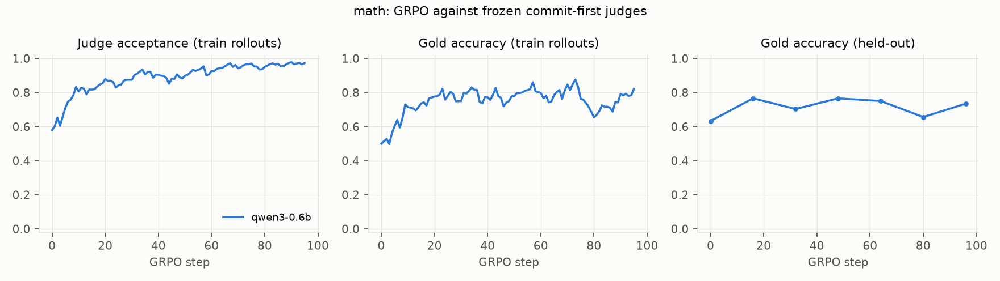

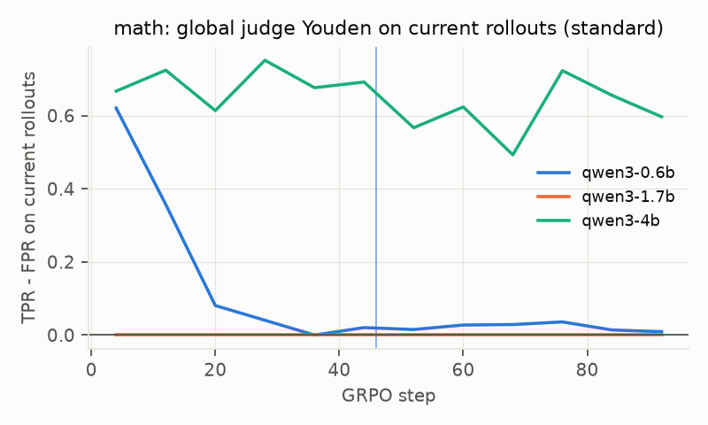 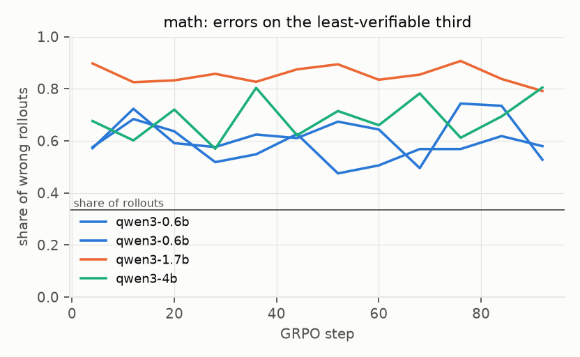

## 3. Predicting per-problem exploitation onset

Univariate C-index of each pre-training feature (risk direction in parentheses):

| feature | direction | c_index |
|---|---|---|
| youden | - | 0.598 |
| youden_nat | - | 0.579 |
| bon_fool_16 | + | 0.667 |
| bon_fool_4 | + | 0.669 |
| solve_gap | + | 0.523 |
| policy_solve | - | 0.734 |
| judge_solve | - | 0.727 |
| base_fp | + | 0.645 |
| syn_neg_accept | + | 0.623 |
| auroc | - | 0.638 |

Discrete-time hazard model, out-of-sample:

| split | features | c_index | nll_per_row | auc_rows | auc_ever | folds |
|---|---|---|---|---|---|---|
| heldout_judge | base FP rate | 0.642 | 0.377 | 0.771 | 0.711 | 3 |
| heldout_judge | solve gap | 0.498 | 0.394 | 0.720 | 0.532 | 3 |
| heldout_judge | solve rates | 0.753 | 0.335 | 0.840 | 0.872 | 3 |
| heldout_judge | time only | 0.500 | 0.396 | 0.721 | n/a | 3 |
| heldout_judge | verifiability | 0.588 | 0.389 | 0.736 | 0.621 | 3 |
| heldout_judge | verifiability + solve | 0.739 | 0.344 | 0.827 | 0.845 | 3 |
| heldout_problems | base FP rate | 0.642 | 0.376 | 0.764 | 0.700 | 5 |
| heldout_problems | solve gap | 0.523 | 0.390 | 0.725 | 0.566 | 5 |
| heldout_problems | solve rates | 0.748 | 0.327 | 0.838 | 0.868 | 5 |
| heldout_problems | time only | 0.500 | 0.391 | 0.721 | n/a | 5 |
| heldout_problems | verifiability | 0.670 | 0.366 | 0.779 | 0.749 | 5 |
| heldout_problems | verifiability + solve | 0.755 | 0.323 | 0.843 | 0.870 | 5 |
| heldout_task | base FP rate | 0.588 | 0.633 | 0.700 | 0.656 | 2 |
| heldout_task | solve gap | 0.479 | 0.679 | 0.645 | 0.512 | 2 |
| heldout_task | solve rates | 0.669 | 0.510 | 0.764 | 0.835 | 2 |
| heldout_task | time only | 0.500 | 0.681 | 0.659 | n/a | 2 |
| heldout_task | verifiability | 0.602 | 0.611 | 0.706 | 0.690 | 2 |
| heldout_task | verifiability + solve | 0.659 | 0.503 | 0.758 | 0.819 | 2 |

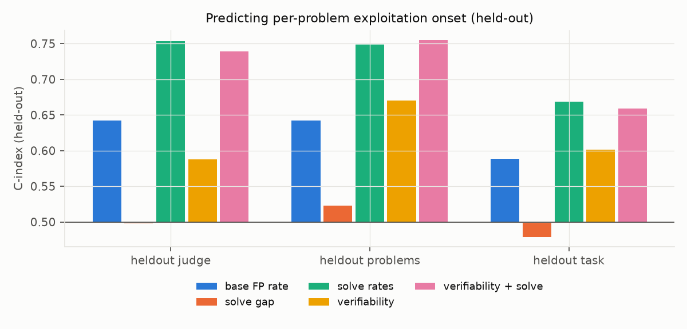

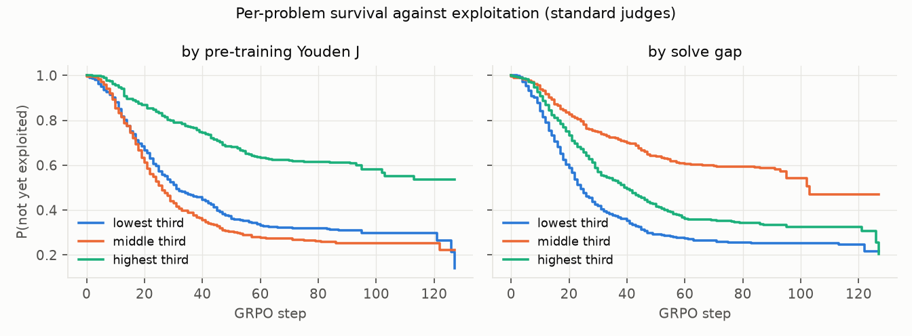

### Alternative event definitions

**fooled** (judge accepts most of a visit's wrong answers) - univariate C and held-out hazard model:

| feature | direction | c_index |
|---|---|---|
| youden | - | 0.554 |
| bon_fool_16 | + | 0.581 |
| solve_gap | + | 0.537 |
| policy_solve | - | 0.530 |
| judge_solve | - | 0.567 |
| base_fp | + | 0.587 |
| auroc | - | 0.569 |

| split | features | c_index | auc_rows | folds |
|---|---|---|---|---|
| heldout_judge | base FP rate | 0.580 | 0.725 | 3 |
| heldout_judge | solve gap | 0.510 | 0.749 | 3 |
| heldout_judge | solve rates | 0.474 | 0.777 | 3 |
| heldout_judge | time only | 0.500 | 0.746 | 3 |
| heldout_judge | verifiability | 0.506 | 0.717 | 3 |
| heldout_judge | verifiability + solve | 0.488 | 0.765 | 3 |
| heldout_problems | base FP rate | 0.586 | 0.723 | 5 |
| heldout_problems | solve gap | 0.534 | 0.778 | 5 |
| heldout_problems | solve rates | 0.490 | 0.797 | 5 |
| heldout_problems | time only | 0.500 | 0.714 | 5 |
| heldout_problems | verifiability | 0.508 | 0.726 | 5 |
| heldout_problems | verifiability + solve | 0.511 | 0.811 | 5 |
| heldout_task | base FP rate | 0.574 | 0.720 | 2 |
| heldout_task | solve gap | 0.534 | 0.767 | 2 |
| heldout_task | solve rates | 0.507 | 0.788 | 2 |
| heldout_task | time only | 0.500 | 0.712 | 2 |
| heldout_task | verifiability | 0.470 | 0.609 | 2 |
| heldout_task | verifiability + solve | 0.506 | 0.770 | 2 |

**unlearned** (gold accuracy falls 0.25 below base while the judge accepts):

| feature | direction | c_index |
|---|---|---|
| youden | - | 0.587 |
| bon_fool_16 | + | 0.629 |
| solve_gap | + | 0.630 |
| policy_solve | - | 0.634 |
| judge_solve | - | 0.683 |
| base_fp | + | 0.617 |
| auroc | - | 0.648 |

| split | features | c_index | auc_rows | folds |
|---|---|---|---|---|
| heldout_judge | base FP rate | 0.618 | 0.707 | 3 |
| heldout_judge | solve gap | 0.620 | 0.684 | 3 |
| heldout_judge | solve rates | 0.692 | 0.758 | 3 |
| heldout_judge | time only | 0.500 | 0.672 | 3 |
| heldout_judge | verifiability | 0.471 | 0.628 | 3 |
| heldout_judge | verifiability + solve | 0.661 | 0.735 | 3 |
| heldout_problems | base FP rate | 0.616 | 0.695 | 5 |
| heldout_problems | solve gap | 0.630 | 0.708 | 5 |
| heldout_problems | solve rates | 0.695 | 0.756 | 5 |
| heldout_problems | time only | 0.500 | 0.660 | 5 |
| heldout_problems | verifiability | 0.605 | 0.701 | 5 |
| heldout_problems | verifiability + solve | 0.692 | 0.755 | 5 |
| heldout_task | base FP rate | 0.540 | 0.605 | 2 |
| heldout_task | solve gap | 0.585 | 0.625 | 2 |
| heldout_task | solve rates | 0.593 | 0.643 | 2 |
| heldout_task | time only | 0.500 | 0.583 | 2 |
| heldout_task | verifiability | 0.502 | 0.593 | 2 |
| heldout_task | verifiability + solve | 0.570 | 0.634 | 2 |

### Slower learning rate (lr 1e-5) runs only

| feature | direction | c_index |
|---|---|---|
| youden | - | 0.576 |
| bon_fool_16 | + | 0.597 |
| solve_gap | + | 0.513 |
| policy_solve | - | 0.655 |
| judge_solve | - | 0.627 |
| base_fp | + | 0.587 |

| split | features | c_index | auc_rows | folds |
|---|---|---|---|---|
| heldout_problems | base FP rate | 0.582 | 0.766 | 5 |
| heldout_problems | solve gap | 0.480 | 0.763 | 5 |
| heldout_problems | solve rates | 0.651 | 0.812 | 5 |
| heldout_problems | time only | 0.500 | 0.757 | 5 |
| heldout_problems | verifiability | 0.594 | 0.768 | 5 |
| heldout_problems | verifiability + solve | 0.666 | 0.817 | 5 |

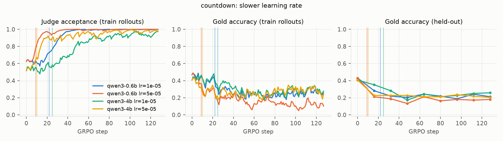

## 4. Causal test (remove 25% of the pool)

| task | arm | heldout_gold_0 | heldout_gold_peak | heldout_gold_final | train_fp_first16 | train_fp_last16 | collapse_onset |
|---|---|---|---|---|---|---|---|
| countdown | train | 0.430 | 0.430 | 0.180 | 0.495 | 0.893 | 9 |
| countdown | drop_gap | 0.430 | 0.430 | 0.039 | 0.301 | 0.971 | 15 |
| countdown | drop_lowver | 0.430 | 0.430 | 0.008 | 0.454 | 0.977 | 10 |
| math | train | 0.633 | 0.750 | 0.742 | 0.170 | 0.242 | 46 |
| math | drop_gap | 0.633 | 0.789 | 0.703 | 0.173 | 0.233 | n/a |
| math | drop_lowver | 0.633 | 0.773 | 0.758 | 0.148 | 0.195 | 34 |

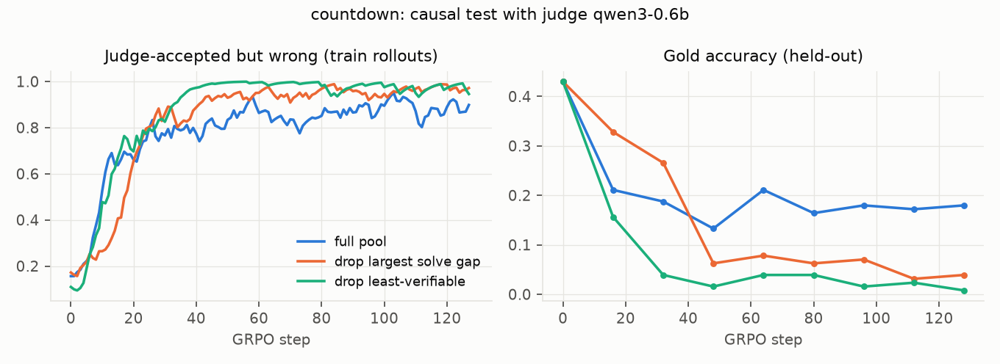

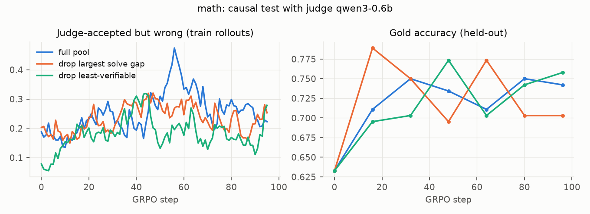

## 5. Commit-first vs standard judging

| task | judge | collapse_onset|commit_first | collapse_onset|standard | heldout_gold_final|commit_first | heldout_gold_final|standard | heldout_gold_peak|commit_first | heldout_gold_peak|standard | pretrain_global_youden|commit_first | pretrain_global_youden|standard | train_fp_last16|commit_first | train_fp_last16|standard |
|---|---|---|---|---|---|---|---|---|---|---|---|
| countdown | qwen3-0.6b | 19.000 | 9.000 | 0.000 | 0.180 | 0.430 | 0.430 | 0.461 | 0.709 | 0.992 | 0.893 |
| countdown | qwen3-1.7b | 10.000 | 10.000 | 0.250 | 0.250 | 0.406 | 0.406 | 0.657 | 0.697 | 0.710 | 0.726 |
| countdown | qwen3-4b | n/a | 10.000 | n/a | 0.203 | n/a | 0.406 | n/a | 0.741 | n/a | 0.716 |
| math | qwen3-0.6b | n/a | 46.000 | 0.734 | 0.742 | 0.766 | 0.750 | 0.335 | 0.555 | 0.208 | 0.242 |
| math | qwen3-1.7b | n/a | n/a | n/a | 0.703 | n/a | 0.703 | n/a | 0.000 | n/a | 0.245 |
| math | qwen3-4b | n/a | n/a | n/a | 0.703 | n/a | 0.766 | n/a | 0.695 | n/a | 0.059 |

### Do exploits transfer across judges?

Rollouts from the first and last epoch of each standard run, re-scored by every judge (`scripts/cross_judge.py`).

**countdown**

| train_judge | epoch | score_judge | fpr | tpr | gold_acc | n |
|---|---|---|---|---|---|---|
| qwen3-0.6b | first | qwen3-0.6b | 0.760 | 1.000 | 0.328 | 192.000 |
| qwen3-0.6b | first | qwen3-1.7b | 0.775 | 1.000 | 0.328 | 192.000 |
| qwen3-0.6b | first | qwen3-4b | 0.574 | 0.921 | 0.328 | 192.000 |
| qwen3-0.6b | last | qwen3-0.6b | 1.000 | 1.000 | 0.109 | 192.000 |
| qwen3-0.6b | last | qwen3-1.7b | 1.000 | 1.000 | 0.109 | 192.000 |
| qwen3-0.6b | last | qwen3-4b | 0.854 | 1.000 | 0.109 | 192.000 |
| qwen3-1.7b | first | qwen3-0.6b | 0.516 | 1.000 | 0.354 | 192.000 |
| qwen3-1.7b | first | qwen3-1.7b | 0.597 | 1.000 | 0.354 | 192.000 |
| qwen3-1.7b | first | qwen3-4b | 0.315 | 0.824 | 0.354 | 192.000 |
| qwen3-1.7b | last | qwen3-0.6b | 1.000 | 1.000 | 0.276 | 192.000 |
| qwen3-1.7b | last | qwen3-1.7b | 1.000 | 1.000 | 0.276 | 192.000 |
| qwen3-1.7b | last | qwen3-4b | 0.906 | 0.962 | 0.276 | 192.000 |
| qwen3-4b | first | qwen3-0.6b | 0.724 | 0.986 | 0.359 | 192.000 |
| qwen3-4b | first | qwen3-1.7b | 0.772 | 1.000 | 0.359 | 192.000 |
| qwen3-4b | first | qwen3-4b | 0.634 | 0.942 | 0.359 | 192.000 |
| qwen3-4b | last | qwen3-0.6b | 0.984 | 1.000 | 0.344 | 192.000 |
| qwen3-4b | last | qwen3-1.7b | 0.984 | 1.000 | 0.344 | 192.000 |
| qwen3-4b | last | qwen3-4b | 0.968 | 0.985 | 0.344 | 192.000 |

**math**

| train_judge | epoch | score_judge | fpr | tpr | gold_acc | n |
|---|---|---|---|---|---|---|
| qwen3-0.6b | first | qwen3-0.6b | 0.431 | 1.000 | 0.625 | 192.000 |
| qwen3-0.6b | first | qwen3-1.7b | 1.000 | 1.000 | 0.625 | 192.000 |
| qwen3-0.6b | first | qwen3-4b | 0.222 | 0.950 | 0.625 | 192.000 |
| qwen3-0.6b | last | qwen3-0.6b | 0.980 | 1.000 | 0.740 | 192.000 |
| qwen3-0.6b | last | qwen3-1.7b | 0.980 | 0.993 | 0.740 | 192.000 |
| qwen3-0.6b | last | qwen3-4b | 0.320 | 0.859 | 0.740 | 192.000 |
| qwen3-1.7b | first | qwen3-0.6b | 0.492 | 1.000 | 0.672 | 192.000 |
| qwen3-1.7b | first | qwen3-1.7b | 1.000 | 1.000 | 0.672 | 192.000 |
| qwen3-1.7b | first | qwen3-4b | 0.159 | 0.930 | 0.672 | 192.000 |
| qwen3-1.7b | last | qwen3-0.6b | 0.796 | 1.000 | 0.745 | 192.000 |
| qwen3-1.7b | last | qwen3-1.7b | 1.000 | 1.000 | 0.745 | 192.000 |
| qwen3-1.7b | last | qwen3-4b | 0.163 | 0.818 | 0.745 | 192.000 |
| qwen3-4b | first | qwen3-0.6b | 0.433 | 0.992 | 0.688 | 192.000 |
| qwen3-4b | first | qwen3-1.7b | 1.000 | 1.000 | 0.688 | 192.000 |
| qwen3-4b | first | qwen3-4b | 0.283 | 0.932 | 0.688 | 192.000 |
| qwen3-4b | last | qwen3-0.6b | 0.658 | 1.000 | 0.802 | 192.000 |
| qwen3-4b | last | qwen3-1.7b | 0.974 | 1.000 | 0.802 | 192.000 |
| qwen3-4b | last | qwen3-4b | 0.395 | 0.942 | 0.802 | 192.000 |

## 6. Label-free early stopping (thresholds tuned on the other task)

| test_task | rule | thr | mean_regret | mean_gain_vs_final | fired | n_runs |
|---|---|---|---|---|---|---|
| countdown | reward_plateau | 0.005 | 0.227 | 0.060 | 1.000 | 7 |
| countdown | monitor_disagree | 0.200 | 0.217 | 0.070 | 0.286 | 7 |
| countdown | lowver_gap | 0.200 | 0.287 | 0.000 | 0.000 | 7 |
| countdown | length_drift | 0.400 | 0.105 | 0.182 | 0.857 | 7 |
| countdown | no stopping (final) | n/a | 0.287 | 0.000 | 0.000 | 7 |
| math | reward_plateau | 0.040 | 0.097 | -0.059 | 1.000 | 7 |
| math | monitor_disagree | 0.050 | 0.069 | -0.031 | 0.429 | 7 |
| math | lowver_gap | 0.050 | 0.077 | -0.039 | 0.857 | 7 |
| math | length_drift | 0.150 | 0.133 | -0.095 | 1.000 | 7 |
| math | no stopping (final) | n/a | 0.038 | 0.000 | 0.000 | 7 |
